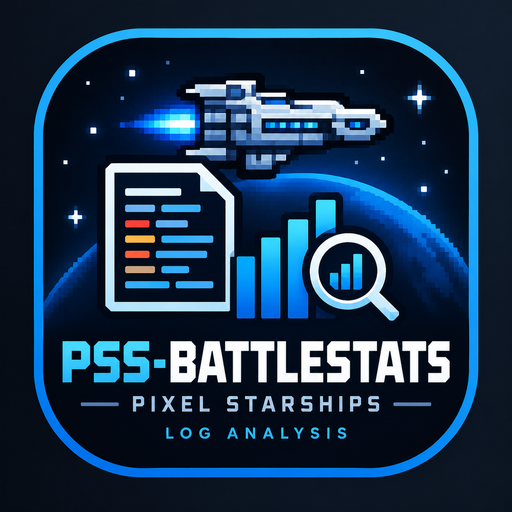

<div align="center">

  

# PSS-BattleStats

**Battle statistics for Pixel Starships, computed locally from you own battle reports.**

[](../../releases)
[](../../actions/workflows/ci.yml)
[](LICENSE)

</div>

PSS-BattleStats listens to the game's own traffic through a local proxy, stores every battle in a local database and shows detailed statistics: damage per room, crew performance, drones, history, plus the game's designs and patch notes (and more soon).

> **Status: beta.** Expect rough edges and please [report bugs](../../issues/new/choose).

<!-- TODO: add a screenshot, e.g.  -->

## Features

- **Automatic capture** of your battle reports while you play, no manual export.
- **Battle details**: per-side summaries, rooms, crew and drones, win/loss history.
- **Crew planning** tab with training, equipment and prestige
- **Designs** and **Patch notes** tabs, with the blog's balance changes and community (UGC) designs.
- **Import** of `.bin` reports and **export** of any battle as JSON.
- **Appearance**: light, dark or system theme, plus fonts, text size and colors.
- **French and English** interface.
- **Update notifications**, with one-click install on Windows (checksum-verified MSI).
- Everything stays **on your machine**: no account, no server.

## How it works

The app starts a local HTTP(S) proxy (`127.0.0.1:8484`) and launches the game through it.
Only traffic to `api.pixelstarships.com` is decrypted, so the app can read the battle report the game receives at the end of a fight.
To do this, your system must trust a **certificate authority generated on your own machines** (see [First launch](#first-launch)).
The private key never leaves your computer.

## Installation

Download the file for your system from the [latest release](../../release/latest).
Each release also provides `SHA256SUMS.txt` to check your download.

### Windows

**Installer (recommended)**

1. Download `PSS-BattleStats-<version>.msi`
2. Run it. Upgrading from an older version works the same way

**Portable**

1. Download `PSS-BattleStats-<version>-windows-x64.zip`, or `-windows-arm64.zip` on ARM devices
2. Unzip it and run `pss-battlestats.exe`

### Linux

1. Download `PSS-BattleStats-<version>-linux-x64.tar.gz`, or `-linux-arm64.tar.gz` on ARM devices
2. Extract it and run the app:

```bash
tar xzf PSS-BattleStats-<version>-linux-x64.tar.gz
cd PSS-BattleStats-<version>-linux-x64
./pss-battlestats
```

The game is expected to be installed through Steam.

### macOS

macOS support is **untested** for now.

1. Download `PSS-BattleStats-<version>-macos-arm64.tar.gz` (Apple silicon) or `-macos-x64.tar.gz` (Intel)
2. Extract it. The binary is not signed, so macOS blocks it at first launch. Remove the quarantine flag once, or right-click the file and choose *Open*:

```bash
tar xzf PSS-BattleStats-<version>-macos-arm64.tar.gz
cd PSS-BattleStats-<version>-macos-arm64
xattr -d com.apple.quarantine pss-battlestats
./pss-battlestats
```

### From source

See [Building from source](#building-from-source)

Each archive contains the app (`pss-battlestats`), the command-line tool (`pss-battlestats-cli`) and the license.

## First launch

1. The app offers to **generate a certificate**. Accept, then install it as a trusted authority when asked:
  - **Windows**: double-click the generated `.crt` file, then *Install Certificate* -> *Local Machine* -> *Trusted Root Certification Authorities*
  - **Linux / macOS**: import the generated `.pem` into your system or browser trust store
2. If the game is not found automatically, set `game_path` in the configuration file (the folder or the executable of Pixel Starships)
3. Start a battle in the game. It appears in the **Battles** tab it ends (but need to refresh)

Files are stored in the usual per-OS locations (for example `~/.config/pss-battlestats` and `~/.local/share/pss-battlestats`) on Linux, `%APPDATA%` and `%LOCALAPPDATA%` on Windows. Set `PSS_BATTLESTATS_DIR` to keep everything in one folder (portable install or backups).

## Building from source

Requires a recent stable [Rust](https://rustup.rs) toolchain.

```bash
git clone https://github.com/TounSec/PSS-BattleStats.git
cd PSS-BattleStats
cargo run -p pss-gui --profile dist
# or
cargo build -p pss-gui --profile dist
# you can found the binary in target/dist/
```

Handy  commands (with [`just`](https://github.com/casey/just)):

|Command|What it does|
|---|---|
|`just run`|Run the GUI|
|`just check`|Format check, clippy and tests (same as the CI)|
|`just fmt`|Format the workspace|

On Linux x86_64, the repository's `.cargo/config.toml` links with `mold`; install it (`apt install mold`) or remove that file.

## Project layout


|Crate|Role|
|---|---|
|`pss-gui`|The desktop app (binary `pss-battlestats`)|
|`pss-capture`|The local capture proxy|
|`pss-codec`|Decoding of the game's battle payloads|
|`pss-model`|Shared data types|
|`pss-store`|Local battle database and file locations|
|`pss-stats`|Statistics computed from battles|
|`pss-designs`|The game's designs catalog and patch notes|
|`pss-cli`|Command-line tools (binary `pss-battlestats-cli`)|

## Contributing

Bug reports and feature requests are welcome through the [issue forms](../../issues/new/choose).
For code contribution, branch from `dev` and run `just check` before opening a pull request.

## Disclaimer

pss-battlestats is a fan-made tool. It is **not affiliated with or endorsed by Savy Soda**, the publisher of Pixel Starships. It only reads the data your own game client receives and does not modify the game.

## License

[MIT](LICENSE) © 2026 TounSec
